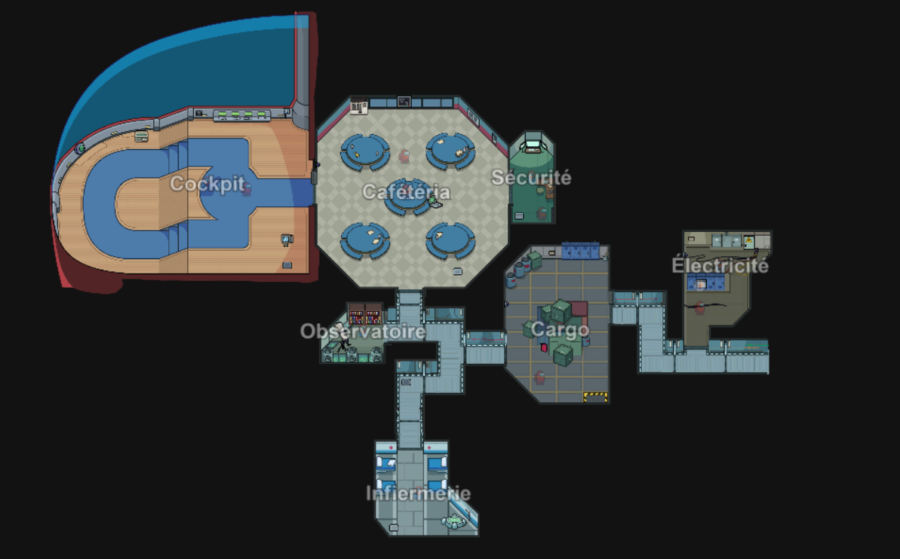
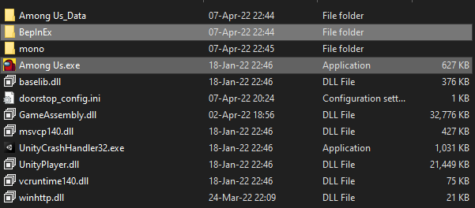
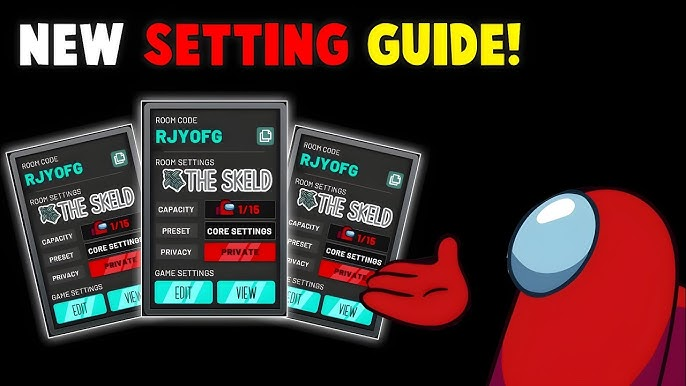

# 🚀 The Skeld Reimagined — Custom Map Project

## 🎮 Presentation of the project

**The Skeld Reimagined** is a project to create a **custom Among Us map** inspired by the famous map **The Skeld**.

The goal of the project is to completely recreate the map with:

* 🏗️ New areas
* 🎨 Personalized artistic direction
* ⚡ New mechanics
* 🔥 A more immersive atmosphere
* 🧩 Unique events and interactions

Development is carried out using the **Level Impostor** mod, allowing the creation of personalized maps in *Among Us*.

---

# 🖼️ Project Overview



---

## ✨ Objectives

The project aims to offer an experience different from the original map:

| Feature | Description |
| ---------------------------- | ------------------------------------------------- |
| 🗺️ New layout | Some rooms will be moved or redesigned |
| 🔐 Interactive systems | Doors, events, animations and dynamic elements |
| 👀 Improved Gameplay | New passages and possible strategies |
| 🎵 Immersive atmosphere | Personalized sounds, lights and decor |
| ⚙️ Multiplayer compatibility | Playable with other players via mod |

---

# 🛠️ Technologies used

* 🎮 **Among Us**
* 🧩 **Level Impostor Mod**
* 💻 Unity
* 🎨 Mapping and design tools

---

# 📸 Concept & Inspiration

The map takes the iconic base of **The Skeld**, while adding a completely new identity.

Main inspirations:

* Futuristic sci-fi
* Abandoned areas
* Industrial complexes
* Modern space stations

---

# 📂 Project structure

```bash
<<<<<<< Updated upstream
📦 The BestSkeld
 ┣ 📂 images
 ┣ 📂 screens
 ┣ ⚖️ LICENSE
 ┗ 📜 README.md
=======
📦The BestSkeld 
┣ 📂 Assets 
┣ 📂 CustomRooms 
┣ 📂 Textures 
┣ 📂 Sounds 
┣ 📂 Scripts 
┗ 📜 README.md
>>>>>>> Stashed changes
```


## Release

<<<<<<< Updated upstream
|                                       Among Us Version                                        |  Version |                                        Links                                        |
|:---------------------------------------------------------------------------------------------:|:-----------------:|:-----------------------------------------------------------------------------------:|
|                                         `v17.4`                                         |   `v2026.6.15`   | [Download](https://github.com/Isax820/TheSkeldReimagined/releases/tag/0.3)
|                                         `v17.3`                                         |   `v2026.6.1`   | [Download](https://github.com/Isax820/TheSkeldReimagined/releases/tag/0.2) |
=======
| Among Us Version | Release | Links |
|:-----------------------------------------------------------------------------------------------:|:-----------------:|:-----------------------------------------------------------------------------------:|
| `v2026.**.*.*` | `v2026.*.**` | [COMING SOON]() |

>>>>>>> Stashed changes

---

# 🧰 Download dependencies

This project (as in the technologies used), requires:

* 🗺️ [Level Imposter](https://github.com/DigiWorm0/LevelImposter/releases)
* 🛠️ [Reactor](https://github.com/NuclearPowered/Reactor) (already included in Level Imposter)

---

# 🌐 INSTALLATION TUTORIAL

- 1 Download the correct ZIP version based on your Among Us version (in [release](https://github.com/Isax820/TheSkeldReimagined#release))

- 2 Access the folder where Among Us is installed: 
- Steam: `C:\Program Files (x86)\Steam\steamapps\common\Among Us` 
- Epic Games: `C:\Program Files\Epic Games\AmongUs`

- 3 Extract the downloaded files there. Make sure the folder is in the same folder as the file (see screenshot below). BepInExAmong Us.exe

- 4 Launch the game (please note that the first launch may take some time)

⚠️ Alternatively, if you already use other mods or have BepInEx installed, you can download the DLL file directly and place it in .BepInEx/plugins

<<<<<<< Updated upstream




---

# 💬 Langues

| Langue               | ❔  |              Status               |
|-------------------------|:--:|:---------------------------------:|
| Français                | ✅  |         Entièrement traduit|
| Chinois              | ❌  |         Non traduit         |
| Anglais                | ❌  |         Non traduit        |
| Italien                 | ❌  |         Non traduit      |
| Espagnol                | ❌ |       Non traduit        |
| Portugais               | ❌  |         Non traduit      |

---

# 📢 Suivre le projet

Tu pourras suivre l’avancement du projet via :

* 💬 [Discord](https://discord.gg/ZdbJnysdrK)

---

# ⭐ Support

Si le projet te plaît :

* ⭐ Mets une étoile au repo
* 🍴 Fork le projet
* 🧠 Propose des idées
* 🐛 Report les bugs

---

# 🔥 Preview

> « Refaire The Skeld… mais en version totalement nouvelle. »

---

<p align="center">
  <b>🚀 The Skeld Reimagined Project 🚀</b>
</p>
=======


![Setting](https://private-user-images.githubusercontent.com/113532396/407338958-464e0 f80-ca8e-4b75-a605-43a7a8d5a50d.jpg?jwt=eyJ0eXAiOiJKV1QiLCJhbGciOiJIUzI1NiJ9.eyJpc3MiO iJnaXRodWIuY29tIiwiYXVkIjoicmF3LmdpdGh1YnVzZXJjb250ZW50LmNvbSIsImtleSI6ImtleTUiLCJleHA iOjE3Nzk2ODk1NDIsIm5iZiI6MTc3OTY4OTI0MiwicGF0aCI6Ii8xMTM1MzIzOTYvNDA3MzM4OTU4LTQ2NGUwZ jgwLWNhOGUtNGI3NS1hNjA1LTQzYTdhOGQ1YTUwZC5qcGc_WC1BbXotQWxnb3JpdGhtPUFXUzQtSE1BQy1TSEE yNTYmWC1BbXotQ3JlZGVudGlhbD1BS0lBVkNPRFlMU0E1M1BRSzRaQSUyRjIwMjYwNTI1JTJGdXMtZWFzdC0xJ TJGczMlMkZhd3M0X3JlcXVlc3QmWC1BbXotRGF0ZT0yMDI2MDUyNVQwNjA3MjJaJlgtQW16LUV4cGlyZXM9MzA wJlgtQW16LVNpZ25hdHVyZT0zOThjNmVjYTNjOWY1NDZjMTc3YTc5NTc4MzFiOGVlMDQ3NTE5ZTU3ZTY5NWU3Y2
>>>>>>> Stashed changes
